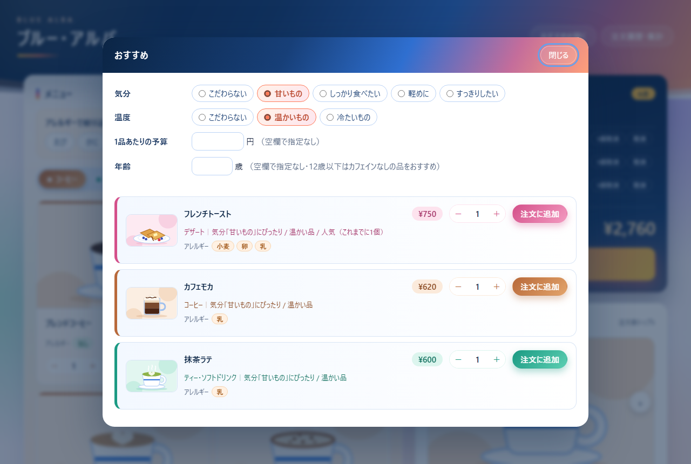
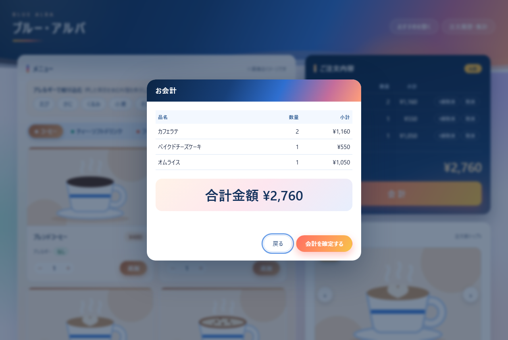
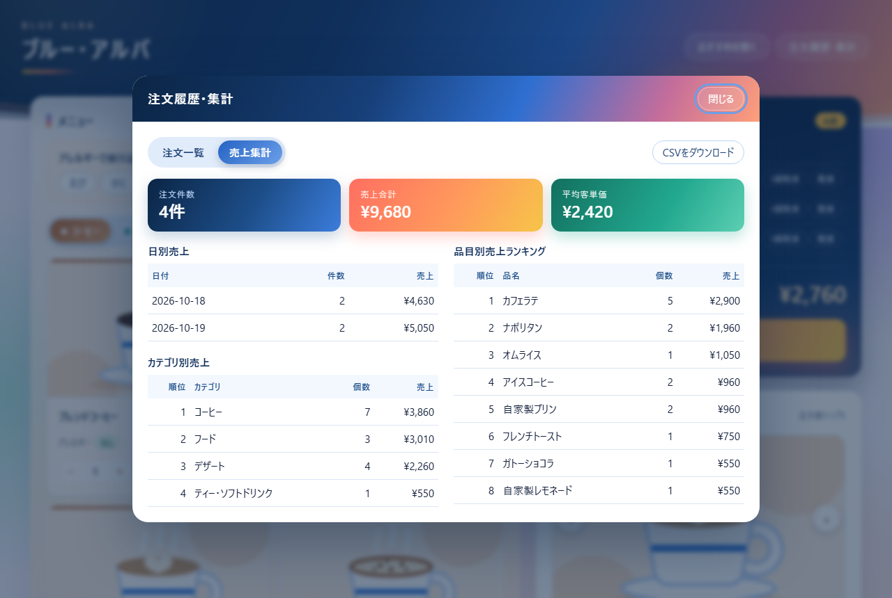

# ブルー・アルバ 注文システム（kdaisuru）

カフェ「ブルー・アルバ」の店頭で使う注文アプリです。
メニューを見て数量を指定して注文し、会計すると注文が記録され、あとから履歴や売上を集計できます。
気分や予算に合わせた「おすすめ」や、アレルギーで料理を絞り込む機能もあります。


同じ機能を、使う場面に合わせて **3つの画面** で用意しています。

| 版 | 起動方法 | 特徴 |
|---|---|---|
| **HTML 版**（メイン） | `index.html` をダブルクリック | ブラウザだけで動く。Python 不要・オフライン可。イラスト・スライド付きのデザイン |
| ウィンドウ版 | `python main.py` | Python（tkinter）のウィンドウアプリ |
| コンソール版 | `python main.py --cli` | 文字だけで操作する版 |

---

## 画面イメージ（HTML 版）

<table>
  <tr>
    <td width="50%"><br><b>アレルギーで絞り込み</b><br>押したアレルギーを含む料理を非表示にします</td>
    <td width="50%"><br><b>おすすめ</b><br>気分・温度・予算・年齢で、合う品を理由付きで提案します</td>
  </tr>
  <tr>
    <td width="50%"><br><b>会計</b><br>「会計」ボタンで注文内容と合計金額を表示します</td>
    <td width="50%"><br><b>注文履歴・売上集計</b><br>日別・カテゴリ別・品目別の売上を集計します</td>
  </tr>
  <tr>
    <td width="50%" align="center"><br><b>スマートフォン表示</b><br>画面幅が狭いときは縦1列に並びます</td>
    <td width="50%">画面の注文データは説明用のサンプルです。<br><br>料理のイラストはイメージです。</td>
  </tr>
</table>

---

## 起動方法

### HTML 版（おすすめ）

`index.html` をダブルクリックするとブラウザで開きます。インストールは不要です。

- 対応ブラウザ: 最新版の Microsoft Edge / Google Chrome / Firefox / Safari
- インターネット接続は不要です（外部のファイルや通信を一切使いません）。

### ウィンドウ版・コンソール版

Python 3.10 以上が必要です（3.14 で動作確認済み）。標準ライブラリだけで動くので、追加のインストールはありません。

```bash
cd kdaisuru
python main.py         # ウィンドウ版
python main.py --cli   # コンソール版
```

> Windows で `python` と打つと Microsoft Store が開く場合は、`py main.py` または Python のフルパスで実行してください。

---

## できること

### メニュー・注文

- 起動すると店名「ブルー・アルバ」を表示
- 4カテゴリ・22品のメニュー（コーヒー / ティー・ソフトドリンク / フード / デザート）をタブで切り替え
- 数量（1〜99）を指定して注文。同じ品を追加すると1行にまとまる
- 会計前なら、1個ずつ・品ごとに注文を取り消せる

### 会計・記録

- 「会計」ボタンで注文内容と **合計金額** を表示し、確定すると注文を記録
- 記録に失敗したときは会計を確定せず、注文はそのまま残る

### 注文履歴・集計

- 注文一覧（注文ID・日時・明細・合計）
- 売上集計：注文件数・売上合計・平均客単価、日別売上、カテゴリ別売上、品目別売上ランキング

### おすすめ

気分・温度・予算・年齢を選ぶと、それに合う品を最大3つ、理由付きでおすすめします。入力を変えるとおすすめも変わります。

- 気分：甘いもの / しっかり食べたい / 軽めに / すっきりしたい
- 温度：温かいもの / 冷たいもの
- 予算：1品あたりの上限金額
- 年齢：12歳以下にはカフェイン入りの品をおすすめしない
- よく注文されている品（人気）を優先

### アレルギー

- 各料理に、特定原材料8品目（えび・かに・くるみ・小麦・そば・卵・乳・落花生）のうち含まれるものを表示
- アレルギーのボタンを押すと、それを含む料理がメニュー・おすすめ・人気メニューから非表示になる（複数選択可）

### 入力チェック

数量・予算・年齢・番号の入力に、文字・マイナス・小数・範囲外の値などを入れても止まらず、理由を表示して入力し直してもらいます。全角数字も使えます。

### HTML 版だけの機能

- 22品それぞれの **参考イラスト**（自作の SVG。※画像はイメージです）
- ご注文内容の下に、注文数の多い上位5品を紹介する **人気メニューのスライド**（自動切り替え・矢印・スワイプ対応。データがないときは注目メニューを紹介）
- 青 × 朝焼け色（店名の「アルバ」＝夜明け）のデザイン。カテゴリごとに色が変わる（コーヒー＝キャラメル、ティー＝ミント、フード＝コーラル、デザート＝ローズ）
- スマートフォンの画面幅にも対応

---

## 注文記録の保存場所

| 版 | 保存先 | 形式 |
|---|---|---|
| ウィンドウ版・コンソール版 | `data/orders.csv`（初回の会計で自動作成） | CSV（Excel で開ける BOM 付き UTF-8） |
| HTML 版 | ブラウザ内（localStorage） | 「注文履歴・集計」画面の **CSVをダウンロード** で、Python 版と同じ形式の CSV を出力できる |

- CSV の列：`注文ID, 日時, 品名, 単価, 数量, 小計, 注文合計`（明細1行ごと）
- HTML 版と Python 版の記録は別々で、共有されません。
- HTML 版の記録は、ブラウザの閲覧データを消すと消えます。必要なら CSV をダウンロードして保存してください。
- `data/` はお店の実データなので、Git には含めません（`.gitignore` で除外）。

---

## ファイル構成

```
kdaisuru/
├── index.html      HTML 版（HTML・CSS・JavaScript・イラストをすべて含む1ファイル）
├── main.py         Python 版の入口（ウィンドウ版 / --cli でコンソール版）
├── gui.py          ウィンドウ版の画面（tkinter）
├── cli.py          コンソール版の画面
├── menu.py         店名・メニュー・価格・おすすめ用タグ・アレルギー情報
├── order.py        注文のルール（追加・取り消し・合計・会計）
├── records.py      注文記録の保存・読み込み・集計
├── recommend.py    おすすめの選び方
├── validation.py   入力チェック
├── docs/images/    README 用のスクリーンショット
├── CLAUDE.md       開発メモ（要件の一覧・設計・決まりごと）
└── README.md       このファイル
```

Python 版は「画面（`gui.py` / `cli.py`）」と「ルール・計算（それ以外）」を分けています。
HTML 版は同じルールを JavaScript で持っています。

---

## メニューや価格を変えるとき

メニュー・価格・アレルギーなどのデータは、**Python 版と HTML 版の2か所** にあります。片方だけ直すと食い違うので、必ず両方を直してください。

| 変えたいもの | Python 版（`menu.py`） | HTML 版（`index.html`） |
|---|---|---|
| 品名・価格・カテゴリ | `MENU` | `MENU` |
| おすすめ用の特徴（甘い・温かい など） | `ITEM_TAGS` | `ITEM_TAGS` |
| アレルギー | `ITEM_ALLERGENS` | `ITEM_ALLERGENS` |
| イラスト | （なし） | `ART` |

- 店名は `menu.py` と `index.html` の `STORE_NAME` です。
- アレルギー情報が登録されていない品は、安全のため、アレルギーで絞り込んでいる間は表示されません。

---

## ご注意

- **各料理のアレルギー情報は、一般的なレシピを想定した仮のデータです。** 実際にお客様へ提供する前に、必ずお店のレシピ・仕入れ品と照らし合わせて確認・修正してください。
- メニュー・価格は一般的なカフェの相場をもとにした仮の設定です（円・税込）。
- 料理のイラストはイメージです。実際の商品とは見た目が異なります。
